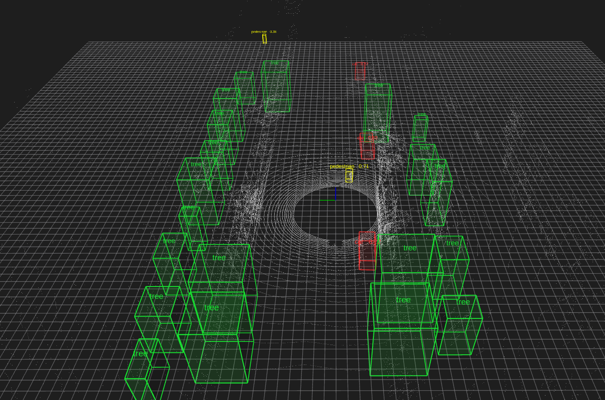
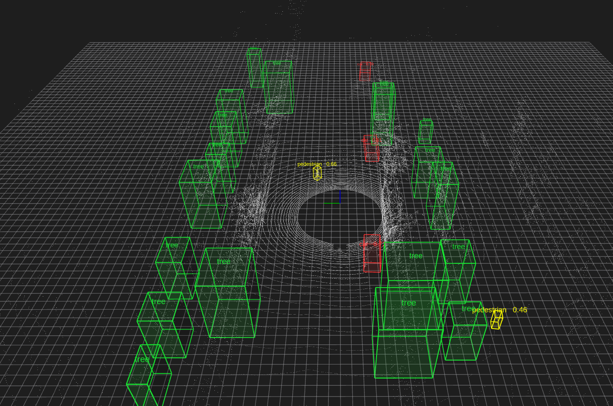
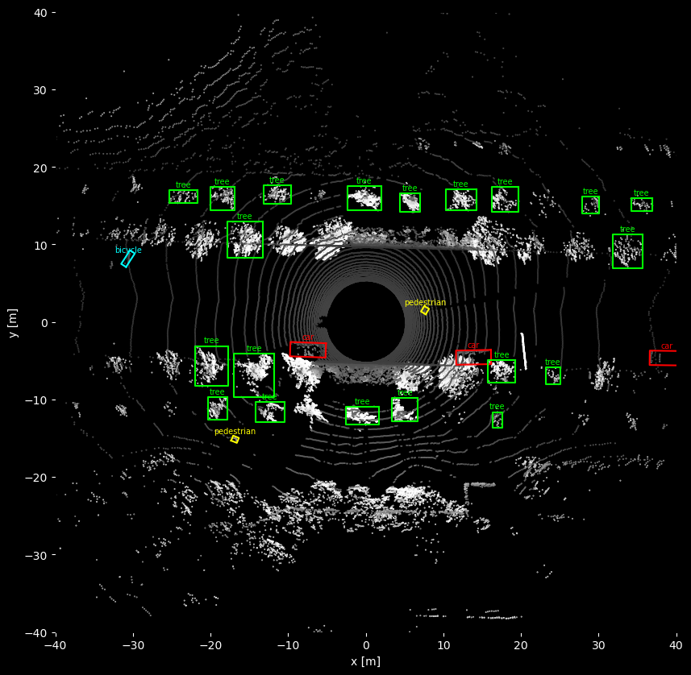

# LiDAR 3D Object Detection in ROS 2 Humble: People, Cars and Trees

Plays a ROS 2 lidar bag and draws **3D bounding boxes around people, cars, trucks, bicycles and trees** in RViz2.

* **People, cars, trucks, buses and bicycles** come from the pretrained
  [Autoware CenterPoint](https://github.com/autowarefoundation/autoware.universe/tree/main/perception/autoware_lidar_centerpoint)
  network. It runs through ONNX Runtime on an NVIDIA GPU, or on the CPU.
* **Trees** are found by shape, because no public pretrained lidar detector has a *tree* class. The detector
  removes the ground, groups the remaining points and keeps tall groups with a narrow trunk and a wider canopy.
* It is plain Python (numpy + onnxruntime). You don't need to compile CUDA code, TensorRT or a colcon build.



| RViz2 view | Bird's-eye view (`offline_eval.py`) |
|---|---|
|  |  |

Box colours: 🟨 pedestrian, 🟥 car, 🟧 truck/bus, 🟦 bicycle, 🟩 tree. Each person, car, truck, bus or bicycle label
shows the model's confidence score.

---

## How it works

```
PointCloud2 ──► ground height estimate ──► CenterPoint (ONNX) ─────────────┐
 (sensor frame)  (densest low z-bin,       • pillars 0.32 m, 480×480 grid  │
                  smoothed over frames)    • voxel encoder → BEV scatter   ├─► 3D boxes ──► MarkerArray ──► RViz2
                        │                  • backbone/head → peaks, NMS    │   (sensor frame)  /perception/object_markers
                        └────────────────► Tree detector ──────────────────┘
                                           • local ground removal
                                           • 2D connected-component clusters
                                           • trunk ≤ 1.2 m wide below 1.6 m,
                                             canopy ≥ 1.5 m wide above 2.2 m,
                                             total height ≥ 3 m
```

1. **Ground alignment.** CenterPoint was trained on points in `base_link`, where the ground is at z = 0. The bag
   has no TF, so the node estimates the ground height under the sensor from the cloud itself (about −2 m for this
   bag) and shifts the points by that amount.
2. **CenterPoint.** This is the Autoware v2 model. `detector.py` re-implements Autoware's CUDA pre- and
   post-processing in numpy:
   * Voxelization: up to 40 000 pillars with up to 32 points each, and 9 features per point.
   * The encoder ONNX model runs on the pillars, and its output is scattered into a 32×480×480 bird's-eye-view
     (BEV) image.
   * The backbone/head ONNX model runs on that image. Heatmap peaks become boxes (x, y, z, l, w, h, yaw), followed
     by non-maximum suppression (NMS).
3. **Trees.** The detector removes the ground per 2 m tile, so it also works on slopes. It then labels connected
   occupied cells on a 0.25 m grid and checks each cluster's trunk and canopy shape. Clusters that overlap a car or
   person box are skipped.
4. **Visualization.** Each object is drawn as three markers: a wireframe box, a see-through filled box and a text
   label. Every new frame first sends a `DELETEALL`, so old boxes are cleared.

## Repository layout

| File | Purpose |
|---|---|
| `detector.py` | Detection core with no ROS dependency: `CenterPoint`, `TreeDetector`, `LidarDetector` |
| `lidar_detector_node.py` | ROS 2 node: `PointCloud2` in → `MarkerArray` out |
| `view_bag.launch.py` | Starts the bag player, the detector node and RViz2 |
| `ped_vehicle.rviz` | RViz2 config (grey point cloud plus the detection markers) |
| `run.sh` | Loads ROS Humble and runs the launch file |
| `offline_eval.py` | Runs the detector straight on a bag; prints detections and saves BEV images |
| `download_models.sh` | Downloads the pretrained CenterPoint ONNX models into `models/` |
| `requirements.txt` | Python packages (onnxruntime-gpu plus the CUDA 12 / cuDNN 9 runtime wheels) |

## Requirements

* Ubuntu 22.04 (native or WSL2) with **ROS 2 Humble** (`ros-humble-desktop`, which includes `rviz2` and `rosbag2`)
* Python 3.10
* Optional: an NVIDIA GPU. The driver alone is enough, because CUDA and cuDNN come as pip wheels. Without a GPU it
  runs on the CPU at about 1 frame per second.

## Installation

```bash
cd ~/ros2_humble/src
git clone https://github.com/PioneerAIRobots/lidar-3d-object-detection-ros2.git bag_viz
cd bag_viz
pip3 install --user -r requirements.txt
./download_models.sh
chmod +x run.sh
```

`download_models.sh` fetches about 20 MB from the Autoware Foundation model server:

| File | Size |
|---|---|
| `pts_voxel_encoder_centerpoint.onnx` | 7 KB |
| `pts_backbone_neck_head_centerpoint.onnx` | 20 MB |
| `centerpoint_ml_package.param.yaml` | <1 KB |

## Usage

Put your rosbag2 folder next to this repo. The default path is
`~/ros2_humble/src/rosbag2_2022_04_14-ped_vehicle`. Then run:

```bash
./run.sh                                  # play bag in a loop + detector + RViz2
./run.sh rate:=0.5                        # half-speed playback
./run.sh bag:=/path/to/other_bag          # another bag
./run.sh score_threshold:=0.5             # fewer, more confident detections
./run.sh detect:=false                    # only show the point cloud
```

### Launch arguments

| Argument | Default | Description |
|---|---|---|
| `bag` | `../rosbag2_2022_04_14-ped_vehicle` | rosbag2 folder |
| `rate` | `1.0` | Playback speed |
| `loop` | `true` | Replay forever |
| `detect` | `true` | Start the detector node |
| `score_threshold` | `0.35` | Minimum CenterPoint confidence |

### Node `lidar_detector`

| | Name | Type |
|---|---|---|
| Subscribes | `/sensing/lidar/top/rectified/pointcloud` (best effort) | `sensor_msgs/PointCloud2` |
| Publishes | `/perception/object_markers` | `visualization_msgs/MarkerArray` |

Parameters: `input_topic`, `model_dir`, `score_threshold` (0.35), `use_gpu` (true), `detect_trees` (true).

You can run the node on its own against any live lidar:

```bash
python3 lidar_detector_node.py --ros-args -p input_topic:=/points_raw
```

To use the GPU outside the launch file, add the pip CUDA libraries to `LD_LIBRARY_PATH`:

```bash
for d in ~/.local/lib/python3.10/site-packages/nvidia/*/lib; do export LD_LIBRARY_PATH=$d:$LD_LIBRARY_PATH; done
```

### Offline evaluation (no RViz)

```bash
source /opt/ros/humble/setup.bash
python3 offline_eval.py --every 20 --out results/
```

## Results

The test data is `rosbag2_2022_04_14-ped_vehicle`: a 64-channel lidar (frame `velodyne_top`), 164 frames over
16.3 s, recorded on a tree-lined street with parked cars and a pedestrian.

| Class | Typical count per frame | Box size (l × w × h) | Confidence |
|---|---|---|---|
| Car | 3–4 | 4.5 × 1.8 × 1.5 m | 0.66 – 0.83 |
| Truck | 1–2 (at about 45 m) | 6.2 × 2.5 × 2.9 m | 0.4 – 0.7 |
| Pedestrian | 1 close (walking past the sensor) plus 1–3 far | 0.8 × 0.7 × 1.8 m | 0.56 – 0.78 (close) |
| Bicycle | 1 | 2.0 × 0.7 × 1.3 m | 0.41 – 0.54 |
| Tree | 17–21 | canopy 2–5 m, height 4–9 m | shape score |

Sample output from `offline_eval.py` (frame 81, tree lines omitted):

```
execution provider: CUDAExecutionProvider
frame 81: 52045 points, 28 objects, 114 ms
    BICYCLE(0.47) c=(-30.6,8.2,-1.2) lwh=(2.1,0.7,1.3) yaw=-2.15
    CAR(0.83) c=(13.9,-4.6,-1.2) lwh=(4.5,1.8,1.5) yaw=0.02
    CAR(0.75) c=(38.8,-4.7,-0.9) lwh=(4.5,1.9,1.6) yaw=-0.01
    CAR(0.73) c=(-7.4,-3.6,-1.2) lwh=(4.6,1.8,1.5) yaw=-0.04
    PEDESTRIAN(0.58) c=(7.6,1.5,-1.0) lwh=(0.8,0.7,1.8) yaw=-2.11
    TRUCK(0.63) c=(-45.3,9.1,-0.4) lwh=(6.7,2.6,3.0) yaw=-3.18
```

### Speed

Measured on an RTX 3080 Laptop GPU with Ubuntu 22.04 on WSL2, about 52 000 points per frame:

| | Time per frame |
|---|---|
| GPU (CUDA Execution Provider), offline | about 100–115 ms |
| GPU, while RViz2 renders in WSLg | about 120–450 ms (CPU contention) |
| CPU only | about 800–900 ms |

Most of the remaining time is spent in numpy voxelization and tree clustering, not in the network.

## Limitations

* **Trees** are found by shape, not by a learned model. Trees whose canopies touch each other or a building can
  merge into one cluster and be rejected. Poles and other objects that have a trunk-and-canopy shape can be
  mislabelled as trees.
* The ground height is one value per frame, so on strongly sloped roads CenterPoint boxes can sit too high or too
  low.
* Only one sweep is used (no multi-frame accumulation), so far-away pedestrians get low scores.
* CenterPoint was trained on Autoware / TIER IV data. On other lidars, adjust `score_threshold` for your sensor.

## Credits

* CenterPoint: T. Yin, X. Zhou, P. Krähenbühl, *Center-based 3D Object Detection and Tracking*, CVPR 2021.
* The pretrained ONNX models and the pre- and post-processing design come from
  [Autoware Universe `lidar_centerpoint`](https://github.com/autowarefoundation/autoware.universe). The models
  are downloaded from the Autoware Foundation and are covered by their license. They are **not** included in this
  repository.
